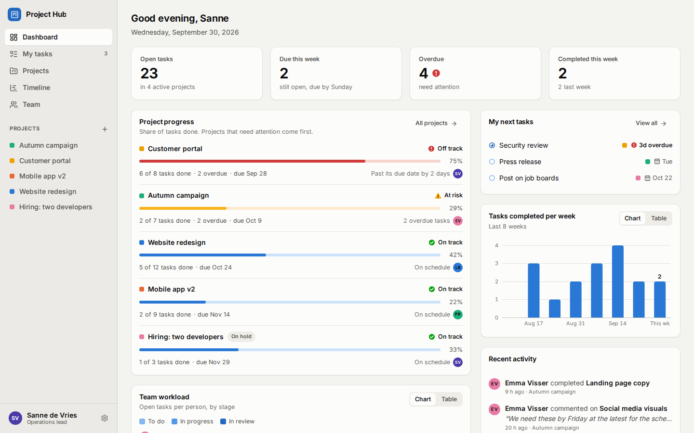
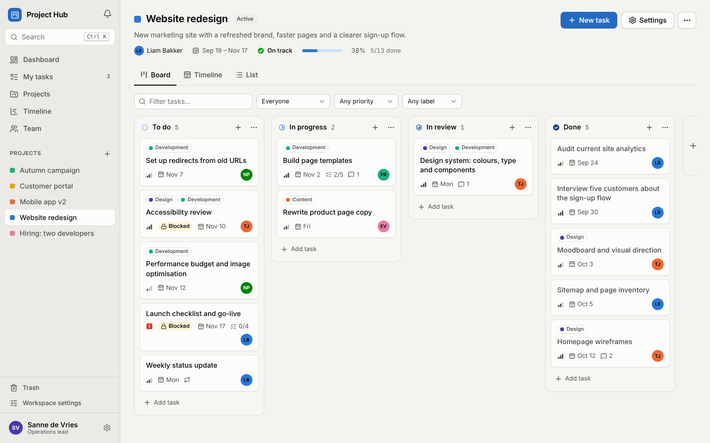
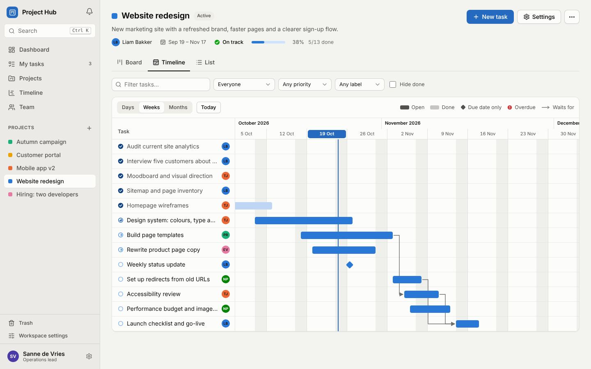
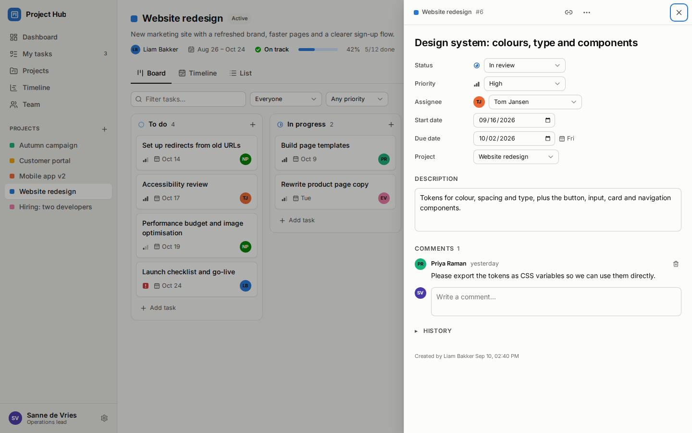
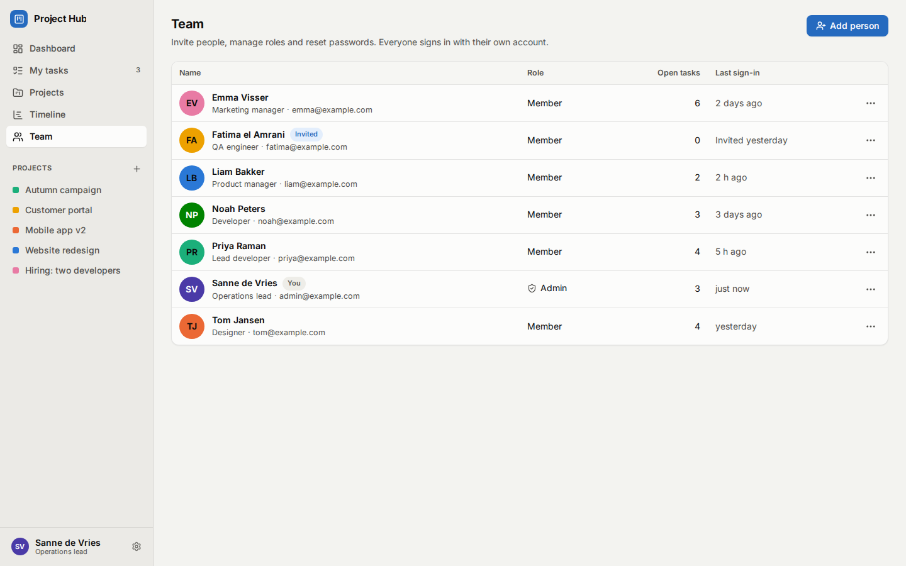
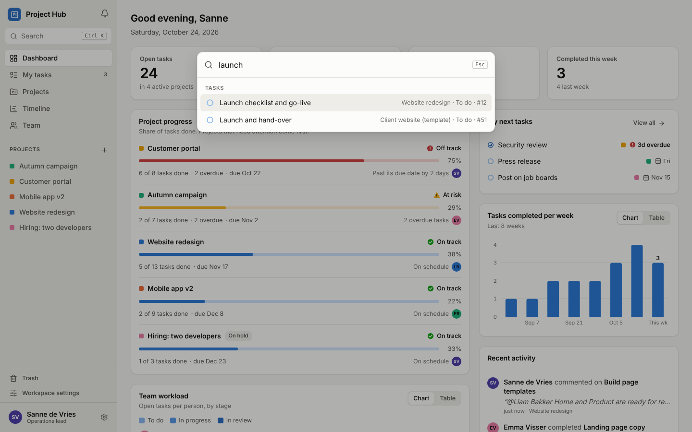
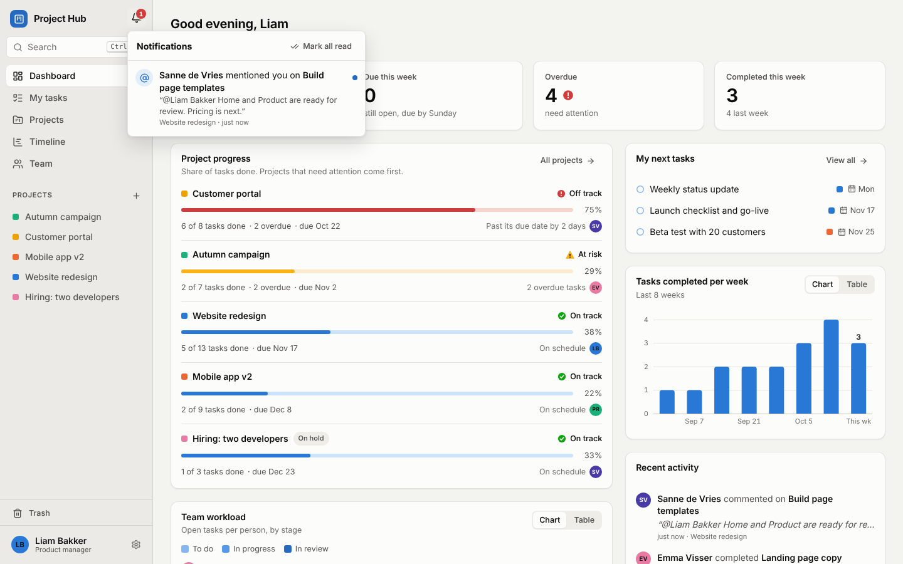
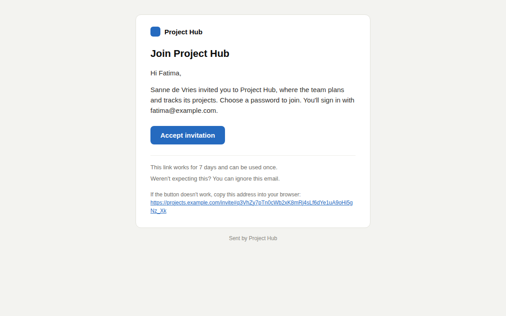
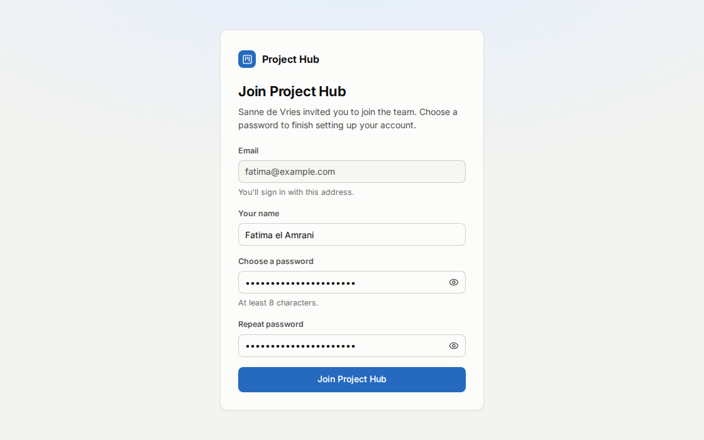

# Project Hub

Self-hosted project management for teams. Everyone on the team signs in with their own account and works from the same Kanban boards, Gantt timeline and progress dashboard. When someone changes something, everyone else sees it straight away.



| Kanban board | Timeline (Gantt) |
| --- | --- |
|  |  |
| **Task details** | **Team and logins** |
|  |  |
| **Search (Ctrl+K)** | **Notifications** |
|  |  |
| **Invitation email** | **Joining from the invitation** |
|  |  |

## Features

**Planning the work**

- **Kanban boards with your own columns.** A new project starts with *To do → In progress → In review → Done*. Owners and admins can add, rename, reorder and remove columns (up to 12), such as *Client review* or *Ready to ship*. Each column counts as one of the four stages, so progress, the dashboard and *My tasks* keep working. Drag cards between columns and reorder them, add a task right from a column, and filter by person, priority, label or text.
- **Labels.** Each project has its own coloured labels, such as *Design* or *Bug*. They show on cards and in the list, and you can filter by them.
- **Checklists.** Break a task into steps you tick off. The card shows how far along it is, like *2/5*.
- **Dependencies.** Mark that a task waits for another one. Waiting tasks show *Blocked* until the other task is done, and the person working on it is told when it's ready to start. The timeline draws arrows between them and warns when the dates don't fit.
- **Recurring tasks.** A task can repeat every day, week, month or year (or every few). When it's completed, the next one is created with the dates moved on.
- **Timeline / Gantt chart.** Drag a bar to move a task, or drag either end to change its start or due date. You can zoom by days, weeks or months. There's a timeline per project and one for all projects together, showing each project's progress. Tasks that only have a due date show as a diamond. Overdue tasks are flagged.
- **Templates and copies.** Save a project as a template, then start new projects from it with all its columns, labels, tasks and checklists, with the dates moved to the new start date. You can also duplicate any project.
- **Assignees and due dates everywhere.** *My tasks* groups the work assigned to you into overdue, today, this week and later.

**Working together**

- **Notifications and @mentions.** Type `@` in a comment to mention someone. People are told when a task is assigned to them, when someone comments on their tasks or mentions them, when a task they're waiting for is done, and the day before something of theirs is due. They appear under the bell, and by email if people want: right away, once a day, or never.
- **File attachments.** Drop files on a task, or paste a screenshot. Images show as thumbnails.
- **Search.** Press **Ctrl+K** (or **⌘K**) anywhere to find tasks, projects and people, and jump straight to them.
- **Task details.** Each task has a description, comments and a full change history. You can link to any task directly.
- **Live updates** for everyone, with no page reload.
- **Calendar feed.** Subscribe to your tasks from Google Calendar, Outlook or Apple Calendar, so due dates show up next to your meetings.

**Keeping track**

- **Progress dashboard.**
  - Headline numbers: open, due this week, overdue and completed this week.
  - Progress per project with an automatic rating: *on track*, *at risk* or *off track*.
  - Each person's workload, split by stage.
  - Tasks completed per week.
  - A feed of recent activity.
- **Export to a spreadsheet.** Download a project's tasks, or (for admins) every task, as a CSV file for Excel, Numbers or Google Sheets.

**People and access**

- **A personal account for each employee.** Admins invite people by email. The invitation has a link to join and choose a password. Without email, admins can share an invite link or hand out a temporary password instead. People who forget their password can get a reset link by email. Admins also set roles, reset passwords and deactivate accounts. Deactivating someone signs them out immediately.
- **Private projects and guests.** A project can be shared with the whole team or kept private to its owner and the people added to it. Invite clients or freelancers as **guests**: they only see the projects they're added to, and can read and comment but not change anything.
- **Two-factor sign-in.** Anyone can turn on codes from an authenticator app, such as Google Authenticator, 1Password or Microsoft Authenticator. They get ten recovery codes for when the phone is lost.
- **Signed-in devices.** See where you're signed in and sign out a lost laptop or phone from anywhere.

**Safety nets**

- **Trash with undo.** Deleted tasks and projects go to the trash for 30 days, and *Undo* is one click away right after deleting.
- **Off-site backups.** Every night, the database and attachments are copied to a storage bucket (Railway, Cloudflare R2, Backblaze B2, AWS S3 or any S3-compatible storage). See [Backups](#backups).
- **Safe upgrades.** Before a new version changes the database, the app saves a copy of it first.

**And also**

- **Light and dark mode**, and it works on phones.
- **Keyboard support.** On the board, press Space to pick up a card, use the arrow keys to move it and press Space again to drop it. On the timeline, use the arrow keys to move a bar by a day.
- **Easy to run.** It's a single Node.js process with a single SQLite database file. You don't need to run a separate database server.

## Quick start with Docker (recommended)

You need Docker with Compose v2.24 or newer.

```bash
docker compose up -d --build
```

Then open **http://localhost:3000**, or `http://<server-address>:3000` from another computer. The first visit asks you to **create the admin account**. Do this straight after starting, before anyone else can reach the page. If you'd rather skip that screen, set `ADMIN_EMAIL` and `ADMIN_PASSWORD` in `.env` before the first start.

All data is stored in the `project-hub-data` Docker volume.

To send invitations and password reset links by email, see [Setting up email](#setting-up-email).

### HTTPS on your own domain

Use this setup when the app is reachable from the internet. It puts [Caddy](https://caddyserver.com) in front of the app, and Caddy fetches and renews the certificate automatically.

1. Point a DNS record, for example `projects.yourcompany.com`, at the server.
2. Create a `.env` file containing `DOMAIN=projects.yourcompany.com`. You can copy `.env.example` as a starting point.
3. Start both containers:

   ```bash
   docker compose -f docker-compose.yml -f docker-compose.caddy.yml up -d --build
   ```

Ports 80 and 443 must be open. If you already run nginx, see [`deploy/nginx.conf.example`](deploy/nginx.conf.example) and set `TRUST_PROXY=1`.

## Running without Docker

You need **Node.js 22.22 or newer**, or Node 24 LTS. No compiler is needed: the SQLite driver ships ready-made binaries for Linux, macOS and Windows.

```bash
npm ci            # install dependencies
npm run build     # build the web app and the server
npm start         # start on http://localhost:3000
```

Settings are read from a `.env` file in this folder (copy `.env.example`). The database is created at `data/project-hub.db`.

To keep the app running after you log out of the server, use a service manager. A minimal systemd unit looks like this:

```ini
# /etc/systemd/system/project-hub.service
[Unit]
Description=Project Hub
After=network.target

[Service]
WorkingDirectory=/opt/project-hub
ExecStart=/usr/bin/node dist/server/index.js
Environment=NODE_ENV=production
Restart=always
User=projecthub

[Install]
WantedBy=multi-user.target
```

## Deploying on Railway

[Railway](https://railway.com) builds the app from the `Dockerfile` and serves it over HTTPS on a Railway address or your own domain.

1. Put this project in a GitHub repository, and in Railway choose **New project → Deploy from GitHub repo**.
2. Add a **volume** to the service, mounted at `/data`. The database lives there. Without a volume, all data is lost on every deploy.
3. Under **Settings → Networking**, generate a domain. Under **Settings → Deploy**, set the healthcheck path to `/healthz`.
4. Set these variables on the service:
   - `RAILWAY_RUN_UID=0`: Railway volumes need this, because the app's image normally runs as a non-root user.
   - `TRUST_PROXY=1`: Railway's edge sits in front of the app.
   - `APP_URL=https://<your app>.up.railway.app`: the domain from step 3, or your own domain.
5. Open the address and create the admin account straight away.
6. Recommended: set up [off-site backups](#off-site-backups-to-a-storage-bucket). On Railway that's a bucket in the same project and four variables.

Good to know:

- Keep a single instance. A Railway volume can only be attached to one, and each deploy has a few seconds of downtime while the volume moves to the new deployment.
- File attachments are stored on the volume too, in `/data/attachments`. Make the volume big enough for them, or set `ATTACHMENT_STORAGE_LIMIT_MB` so uploads stop before the volume fills up.
- Railway's Free, Trial and Hobby plans block outgoing SMTP email. Use Resend there (see [Sending through Resend](#sending-through-resend-instead-of-smtp)).
- To use the command-line tools, open a shell in the service with `railway ssh` and run, for example, `node dist/server/cli.js list-users`.

## Setting up email

Email is optional. With it, the app can:

- email invitations to new team members, and
- send reset links to people who click **Forgot your password?**.

Without email, everything else works the same. Admins share invite links or temporary passwords instead, and reset passwords for people.

The app sends email over SMTP. Your company's mail server works, and so does any email service that offers SMTP. Ask your provider for the server name, port, username and password, then add them to `.env`:

```bash
APP_URL=https://projects.yourcompany.com     # the address people open the app on; links in emails point here
SMTP_HOST=smtp.yourprovider.com
SMTP_PORT=587
SMTP_USER=projects@yourcompany.com
SMTP_PASSWORD=your-smtp-password
MAIL_FROM="Project Hub <projects@yourcompany.com>"
```

Restart the app: `docker compose up -d`, or restart the service. The log then says `Email: ready`, or explains what's wrong. To check the settings, send yourself a test message:

```bash
npm run cli -- send-test-email --to you@yourcompany.com
# Docker: docker compose exec app node dist/server/cli.js send-test-email --to you@yourcompany.com
```

Good to know:

- **Port 587** is the usual choice. The connection is upgraded to TLS (STARTTLS). On **port 465**, the app uses TLS from the start automatically. `SMTP_SECURE=true` or `false` overrides this.
- **`MAIL_FROM`** must be an address your provider lets you send from. Otherwise messages are refused or land in spam. Most providers ask you to verify the sender's domain first.
- **"Forgot your password?" needs `APP_URL`.** Without it, the link on the sign-in page stays hidden. That way, a forged request can never produce a reset link that points to another site. Invitations work without `APP_URL`: their links use the address the admin has open.
- **To try email on your own computer** without sending real messages, run a test inbox such as [Mailpit](https://mailpit.axllent.org). It accepts mail on port 1025 and shows it at http://localhost:8025. Set `SMTP_HOST=localhost`, `SMTP_PORT=1025` and a `MAIL_FROM`.

### Sending through Resend instead of SMTP

Some hosts block outgoing mail ports, including Railway's Free, Trial and Hobby plans. The app can also send through [Resend](https://resend.com), which works over HTTPS:

1. Create a Resend account and verify your domain there. Until a domain is verified, Resend only delivers to your own address.
2. Create an API key. Sending access is enough.
3. Set `RESEND_API_KEY` to that key, and `MAIL_FROM` to an address on the verified domain, such as `MAIL_FROM="Project Hub <projects@yourcompany.com>"`. Set `APP_URL` too.

When `RESEND_API_KEY` is set, it's used instead of the SMTP settings. The `send-test-email` command works the same way.

## Adding your team

Open **Team → Add person**. Enter their name, work email, an optional job title and their role (member, admin or guest). Then choose how they get access:

- **Email an invitation.** They get an email with a link to join and choose their own password. This needs [email](#setting-up-email).
- **Share an invite link.** The app gives you the link, and you send it yourself, for example in a chat message.
- **Set a temporary password.** The app makes one up and shows it once, or you type your own. They sign in with it, then choose their own password.

Invitation links work once and expire after 7 days (`INVITE_TTL_DAYS`). Until someone joins, the Team page shows them as *Invited* and says when the invitation went out, or that it expired. Their **⋯** menu lets you resend the email, get a new link (earlier links stop working) or revoke the invitation. You can assign tasks to people before they join.

**Forgotten passwords.** With email set up, people click **Forgot your password?** on the sign-in page and get a link that works for 60 minutes. Admins can also open **Team → ⋯ → Reset password…** to email someone a reset link or give them a temporary password.

When someone leaves, choose **Deactivate**. Their tasks and comments are kept, and you can reactivate them later.

| Who | Can do |
| --- | --- |
| **Guest** | For clients and freelancers. See only the projects they're added to. Read everything there, comment and @mention people. They can't change tasks, and they only see the people who work on those projects. |
| **Member** | See every project shared with the team, plus private projects they own or were added to. Create projects. Create, edit, move and comment on tasks. Delete tasks they created. Change the settings, columns and members of projects they own. |
| **Admin** | Everything a member can do, plus seeing every project, managing people, changing any project, deleting any task or comment, emptying the trash, and **Workspace settings** (backups, storage use and a full export). |

The app always keeps at least one active admin.

**Private projects.** In a project's **Settings**, choose who can see it: the whole team, or only the owner, the people you pick and admins. Guests are added the same way: add them to the project's people.

**Two-factor sign-in.** Everyone can turn it on under **Account settings** (the ⚙ next to your name): scan the QR code with an authenticator app and type a code to confirm. Keep the ten recovery codes somewhere safe; each works once if the phone is lost. If someone loses both, an admin can turn it off for them under **Team → ⋯ → Turn off two-factor sign-in**, or run `disable-2fa` from the [command line](#command-line-tools).

**Signed-in devices.** **Account settings** also lists every browser where you're signed in, with when it was last used. Sign out one you don't recognise, or all except this one.

## Trying it out with demo data

On an **empty** database, the following command adds a demo team with six people (plus one open invitation), six projects, a project template and about forty tasks, some with labels, checklists and dependencies:

```bash
npm run build && npm run cli -- seed-demo
# Docker: docker compose exec app node dist/server/cli.js seed-demo
```

Sign in as `admin@example.com` (admin) or `liam@example.com` (member). The password for both is `demo1234`. To start over with real data, delete the database file (without Docker) or the volume: `docker compose down -v`.

## Configuration

Set these as environment variables or in `.env`. All of them are optional.

| Variable | Default | What it does |
| --- | --- | --- |
| `APP_NAME` | `Project Hub` | Name shown in the app and in the browser tab. |
| `PORT` | `3000` | HTTP port. |
| `HOST` | `0.0.0.0` | Network interface to listen on. |
| `DATABASE_PATH` | `./data/project-hub.db` | SQLite file. Docker uses `/data/project-hub.db`. |
| `TRUST_PROXY` | *(off)* | The number of proxies in front of the app: `1` behind one reverse proxy or load balancer (Railway, Caddy, nginx), so it sees real client IPs and detects HTTPS. Only that many `X-Forwarded-For` entries are believed, so clients can't fake their address. `true` trusts all of them. |
| `COOKIE_SECURE` | `auto` | `auto` marks the session cookie *Secure* when the request came in over HTTPS. `true` or `false` forces it on or off. |
| `SESSION_TTL_DAYS` | `30` | How long people stay signed in without using the app. |
| `LOGIN_RATE_LIMIT` | `20` | Failed sign-in attempts allowed per IP address per 15 minutes. |
| `ADMIN_EMAIL`, `ADMIN_PASSWORD`, `ADMIN_NAME` | – | Creates the first admin on startup if there are no accounts yet. |
| `APP_URL` | – | The address people open the app on, such as `https://projects.yourcompany.com`. Links in emails point here. Needed for *Forgot your password?* |
| `SMTP_HOST` | – | Mail server for invitations and reset links. Email is off without it. |
| `SMTP_PORT` | `587` | Mail server port. |
| `SMTP_SECURE` | `true` on port 465, otherwise `false` | `true`: TLS from the start. `false`: upgrade to TLS with STARTTLS. |
| `SMTP_USER`, `SMTP_PASSWORD` | – | Mail server login, if it needs one. |
| `MAIL_FROM` | `SMTP_USER` | Sender of the emails, such as `"Project Hub <projects@yourcompany.com>"`. Required when `SMTP_USER` isn't an email address. |
| `RESEND_API_KEY` | – | Send email through Resend's HTTPS API instead of SMTP. Needs `MAIL_FROM` on a domain verified in Resend. |
| `INVITE_TTL_DAYS` | `7` | How many days invitation links work. |
| `MAX_UPLOAD_MB` | `25` | Largest file someone can attach to a task. |
| `ATTACHMENT_STORAGE_LIMIT_MB` | `0` (no limit) | Total space attachments may take. Uploads are refused once it's reached. |
| `ATTACHMENTS_DIR` | `attachments` next to the database | Where attached files are stored. Keep it on the same volume as the database. |
| `BACKUP_S3_BUCKET` | – | Bucket for [off-site backups](#off-site-backups-to-a-storage-bucket). Backups are off without it. |
| `BACKUP_S3_ENDPOINT` | – | The storage service's address, such as `https://t3.storageapi.dev` (Railway) or `https://<account>.r2.cloudflarestorage.com` (Cloudflare R2). |
| `BACKUP_S3_ACCESS_KEY_ID`, `BACKUP_S3_SECRET_ACCESS_KEY` | – | Keys for the bucket. They need permission to list, read, write and delete objects. |
| `BACKUP_S3_REGION` | `auto` | Region of the bucket. Most services accept `auto`; AWS S3 needs the real one, such as `eu-west-1`. |
| `BACKUP_S3_PREFIX` | `project-hub/` | Folder inside the bucket for the backups. |
| `BACKUP_S3_PATH_STYLE` | `false` | Set to `true` for services that need `endpoint/bucket/` addresses, such as MinIO. |
| `BACKUP_HOUR_UTC` | `2` | Hour of the day (UTC) after which the nightly backup runs. |
| `BACKUP_KEEP_DAYS` | `30` | How long database copies are kept in the bucket. The newest seven are always kept. |

## Backups

The whole workspace is one SQLite file, plus the `attachments` folder next to it for files attached to tasks.

### Off-site backups to a storage bucket

Set this up when the app holds real work. Without it, the database, its local backups and the attachments all live on one disk; if that disk is lost, so is everything.

With a bucket configured, the app uploads a compressed copy of the database every night (after `BACKUP_HOUR_UTC`, 02:00 UTC by default), plus any attachments that aren't in the bucket yet. Database copies older than `BACKUP_KEEP_DAYS` are removed; the newest seven are always kept. Admins see when the last backup ran, and can start one, under **Workspace settings**.

Any S3-compatible storage works: Railway buckets, Cloudflare R2, Backblaze B2, AWS S3 or MinIO. Create a bucket and an access key that can list, read, write and delete in it, then set:

```bash
BACKUP_S3_BUCKET=project-hub-backups
BACKUP_S3_ENDPOINT=https://<account-id>.r2.cloudflarestorage.com   # your storage service's S3 address
BACKUP_S3_ACCESS_KEY_ID=...
BACKUP_S3_SECRET_ACCESS_KEY=...
```

**On Railway:** in the same project, choose **Create → Bucket**. Then, on the Project Hub service, add these variables. Replace `Bucket` with your bucket's name as Railway shows it; the variable editor suggests the references as you type `${{`.

```bash
BACKUP_S3_BUCKET=${{Bucket.BUCKET}}
BACKUP_S3_ENDPOINT=${{Bucket.ENDPOINT}}
BACKUP_S3_ACCESS_KEY_ID=${{Bucket.ACCESS_KEY_ID}}
BACKUP_S3_SECRET_ACCESS_KEY=${{Bucket.SECRET_ACCESS_KEY}}
BACKUP_S3_REGION=${{Bucket.REGION}}
```

If the bucket's **Credentials** tab says to use path-style URLs (older Railway buckets), also set `BACKUP_S3_PATH_STYLE=true`.

To check the settings straight away, open **Workspace settings → Back up now**, or run `backup --remote` from the [command line](#command-line-tools).

### Local copies

To make a copy on the server itself while the app is running:

```bash
npm run cli -- backup                         # writes data/backups/project-hub-<date>.db
npm run cli -- backup --out /mnt/nas/ph.db    # or choose the file yourself

# Docker
docker compose exec app node dist/server/cli.js backup
docker compose cp app:/data/backups ./backups
```

Without a bucket, copy these off the server regularly, for example with a nightly cron job:
`0 2 * * * cd /opt/project-hub && docker compose exec -T app node dist/server/cli.js backup`

Before a new version changes the database, the app also saves a copy in the same `backups` folder, named `before-upgrade-v<version>-<date>.db`.

### Restoring

1. Get the copy you want. From the bucket: `list-remote-backups` shows them, newest first, and `download-backup --key <name> --out restore.db` downloads and unzips one.
2. Stop the app.
3. Replace `project-hub.db` with the copy and delete any `project-hub.db-wal` or `-shm` files next to it.
4. If the attachments folder was lost too, copy the `attachments/` folder from the bucket back next to the database (any S3 tool works, such as `aws s3 sync` or `rclone`).
5. Start the app again.

## Updating

Copy in the new code, then run `docker compose up -d --build`. Without Docker, run `npm ci && npm run build` and restart. On Railway, push to the branch it deploys from. Database changes are applied automatically when the app starts, and the app saves a copy of the database first (see [Local copies](#local-copies)).

## Command-line tools

```bash
npm run cli -- <command>                               # after npm run build
docker compose exec app node dist/server/cli.js <command>   # with Docker
```

| Command | Purpose |
| --- | --- |
| `create-user --email a@b.com --name "Ann" [--role admin\|member\|guest]` | Adds an account and prints a temporary password. |
| `reset-password --email a@b.com` | Sets a new temporary password, reactivates the account and signs it out everywhere. **Use this if you're locked out as the only admin.** |
| `disable-2fa --email a@b.com` | Turns off two-factor sign-in for someone who lost their phone and their recovery codes. |
| `list-users` | Lists all accounts, and whether each one is active, invited or deactivated. |
| `send-test-email --to a@b.com` | Checks the email settings by sending a test message. |
| `backup [--out file] [--remote]` | Makes a consistent backup of the database. With `--remote`, uploads one to the backup bucket now. |
| `list-remote-backups` | Lists the database backups in the bucket, newest first. |
| `download-backup --key <name> [--out file]` | Downloads and unzips a backup from the bucket, for restoring. |
| `seed-demo` | Adds demo data to an empty database. |

## Security

- Passwords are hashed with **scrypt** (N=2¹⁵, r=8, p=3), and each hash stores its own parameters.
- Sessions use random 256-bit tokens, and only their SHA-256 hashes are stored. The session cookie is `HttpOnly`, `SameSite=Strict` and `Secure` over HTTPS. Sessions extend while in use and expire after `SESSION_TTL_DAYS` of inactivity.
- Changing your password signs out your other sessions. An admin reset or a deactivation signs the person out everywhere, including open live-update connections.
- Invitation and reset links carry a random 256-bit token, and only its SHA-256 hash is stored. Each link works once and expires: after 7 days for invitations, after 60 minutes for resets. Sending a newer link cancels the older one. The token comes after the `#` in the link, and browsers never send that part to a server, so it stays out of server and proxy logs.
- Asking for a reset link gets the same answer whether or not the address has an account. The email goes out in the background, so the response time gives nothing away either. These requests are rate-limited, and one person gets at most one email a minute. The current password keeps working until the link is used. Using it signs the person out everywhere else.
- Every state-changing request must carry a custom header, which protects against cross-site request forgery. Sign-in attempts are rate-limited. Unknown email addresses take as long to reject as wrong passwords, so the response time doesn't reveal who has an account.
- Two-factor sign-in uses standard 6-digit authenticator codes (TOTP, RFC 6238). A code can't be used twice, and after the password step there are five minutes and five tries to enter it. Recovery codes are stored only as hashes. Turning it on signs out your other devices.
- Who sees what is checked on the server for every request, search result, live update, notification and calendar entry: private projects and guests never leak through a side door. Guests can't change work even if they call the API directly.
- Attached files are stored under random names, outside the web folder, and only sent to people who can see the task. They're always downloaded rather than opened as a page in the app, except common image types, which are checked to really be images. SVG files are never shown inline, because they can carry scripts.
- The calendar feed works without signing in, so its address contains a random 192-bit token; only its hash is stored. Anyone with the address can read your task list, so treat it like a password. You can replace or turn off the address under **Account settings** at any time.
- Spreadsheet exports protect against formula injection: cells that start with `=`, `+`, `-`, `@` or a tab are prefixed with `'` so spreadsheet apps don't run them as formulas.
- Backups are sent over HTTPS, signed with AWS Signature Version 4. The keys only need access to that one bucket.
- Security headers, including a strict Content Security Policy, are set with [helmet](https://helmetjs.github.io). No third-party requests are made: fonts are served from the app itself.
- Run the app behind HTTPS whenever it's reachable outside a trusted network.

## Development

```bash
npm install
npm run dev        # API on :3000 (restarts on change) + web app on :5173 (hot reload)
```

Open http://localhost:5173. Vite forwards `/api` requests to the API server.

```bash
npm test           # API tests (Vitest + Supertest, in-memory database, temporary attachments folder)
npm run typecheck  # TypeScript checks for the server, the web app and the tests
npm run build      # production build into dist/
```

**Stack:** Node.js with Express 5, SQLite (better-sqlite3) and Zod on the server. React 19, TanStack Query, React Router, dnd-kit and Vite on the client. Everything is written in TypeScript.

```text
src/
  shared/     types, date helpers, recurrence, mentions and project-health rules used by both sides
  server/
    index.ts      entry point           app.ts        Express app (routes, security, static files)
    db/           connection + schema migrations (with a copy saved before upgrades)
    auth/         passwords, sessions, two-factor codes, invitation/reset link tokens, auth middleware
    repos/        SQL for users, projects, columns, labels, tasks, checklists, dependencies, attachments, notifications…
    routes/       HTTP endpoints
    services/     permissions, notifications, trash, project copies, backups, calendar, CSV, background jobs
    lib/          validation, errors, live-update hub, S3 client, email sending and templates
    cli.ts        command-line tools    seed.ts       demo data
  client/
    pages/        one file per screen    features/     board, timeline, task drawer, search, notifications, labels, account…
    components/   shared UI              api/          API client, queries, live updates
    styles/       design tokens (light/dark) and styles
tests/          API tests
```

### API overview

Every endpoint is under `/api`. Every request that changes something must send an `X-Requested-With` header, and `Content-Type: application/json` (file uploads send the file itself as the body, with its name in `X-File-Name`).

| Area | Endpoints |
| --- | --- |
| Auth | `GET auth/status` · `POST auth/setup` · `POST auth/login` · `POST auth/login/verify` (two-factor code) · `POST auth/logout` · `GET/PATCH auth/me` · `POST auth/password` |
| Account | `GET auth/sessions` · `DELETE auth/sessions/:id` · `POST auth/sessions/sign-out-others` · `POST auth/2fa/setup` · `POST auth/2fa/enable` · `POST auth/2fa/disable` · `POST auth/2fa/recovery-codes` · `POST/PATCH/DELETE auth/calendar` |
| Links | `POST auth/invitation/lookup` · `POST auth/invitation/accept` · `POST auth/password-reset/request` · `POST auth/password-reset/lookup` · `POST auth/password-reset/complete` |
| People | `GET users` · `POST users` · `PATCH users/:id` · `POST users/:id/invite` · `DELETE users/:id` (revokes an invitation) · `POST users/:id/reset-password` · `POST users/:id/disable-2fa` (admin) |
| Projects | `GET projects[?includeArchived=true&templates=include\|only]` · `POST projects` · `GET/PATCH/DELETE projects/:id` · `POST projects/:id/duplicate` · `PUT projects/:id/members` · `GET projects/:id/export.csv` |
| Columns, labels | `POST projects/:id/columns` · `PUT projects/:id/columns/order` · `PATCH/DELETE columns/:id` · `POST projects/:id/labels` · `PATCH/DELETE labels/:id` |
| Tasks | `GET tasks[?projectId=&assigneeId=me&status=todo,review]` · `POST tasks` · `GET/PATCH/DELETE tasks/:id` · `POST tasks/:id/move` |
| Task details | `GET/POST tasks/:id/checklist` · `PUT tasks/:id/checklist/order` · `PATCH/DELETE checklist/:id` · `GET tasks/:id/dependencies` · `POST tasks/:id/blockers` · `DELETE tasks/:id/blockers/:blockerId` · `GET/POST tasks/:id/attachments` · `GET attachments/:id/file` · `PATCH/DELETE attachments/:id` |
| Comments | `GET/POST tasks/:id/comments` · `PATCH/DELETE comments/:id` |
| Inbox | `GET search?q=` · `GET notifications` · `POST notifications/read` |
| Trash | `GET trash` · `POST trash/tasks/:id/restore` · `POST trash/projects/:id/restore` · `DELETE trash/tasks/:id` · `DELETE trash/projects/:id` · `DELETE trash` (admin) |
| Admin | `GET admin/status` · `POST admin/backup` · `GET export/tasks.csv` |
| Other | `GET dashboard` · `GET activity` · `GET events` (Server-Sent Events) · `GET calendar/:token.ics` (no sign-in) · `GET /healthz` |

### Notes for contributors

- The `.npmrc` file turns off npm install scripts, so npm doesn't try to compile the SQLite driver. None of the current dependencies need an install script. If you add a package that does (sharp or Prisma, for example), run its setup step by hand or adjust `.npmrc`.
- To change the database schema, add a new entry to the end of `src/server/db/migrations.ts`. Never edit an entry that has already shipped.

## Troubleshooting

- **Locked out as the only admin:** run `reset-password --email you@company.com` (see *Command-line tools*).
- **Lost the phone with the authenticator app:** sign in with one of your recovery codes instead of a code, then set up two-factor again. Without recovery codes, ask an admin to turn it off for you, or run `disable-2fa --email you@company.com`.
- **Two-factor codes are always rejected:** check that the phone's clock is set automatically. Codes change every 30 seconds, so a clock that's a minute or more off produces wrong codes.
- **Backups fail:** **Workspace settings** shows the error from the storage service. `SignatureDoesNotMatch` or `InvalidAccessKeyId` means the keys are wrong; `NoSuchBucket` means a wrong bucket name or endpoint; on AWS S3, also check `BACKUP_S3_REGION`. Older Railway buckets need `BACKUP_S3_PATH_STYLE=true`.
- **Uploads fail with "storage is full":** raise `ATTACHMENT_STORAGE_LIMIT_MB`, or delete files you no longer need. Files on tasks in the trash count until the trash is emptied.
- **Invitation emails don't arrive:** look for the `Email:` line in the log when the app starts, and run `send-test-email`. If the test arrives but invitations land in spam, ask your email provider how to verify the domain in `MAIL_FROM`. In the meantime, use **Get a new invite link** and send the link yourself.
- **On Railway, emails fail with a connection error:** outgoing SMTP is blocked on Railway's Free, Trial and Hobby plans. Use Resend instead.
- **Links in emails point to the wrong address** (such as `http://localhost:3000`): set `APP_URL`.
- **There's no "Forgot your password?" link:** it appears once both email and `APP_URL` are set up.
- **Signing in doesn't stick:** you probably set `COOKIE_SECURE=true` but open the app over plain HTTP. Use HTTPS, or leave it on `auto`.
- **Behind a proxy, everyone hits the sign-in limit together, or the logs mention `X-Forwarded-For`:** set `TRUST_PROXY=1`.
- **Live updates don't arrive behind nginx:** use `proxy_buffering off;` as in `deploy/nginx.conf.example`.
- **`npm install` tries to compile `better-sqlite3`:** make sure the `.npmrc` file from this project is present.
